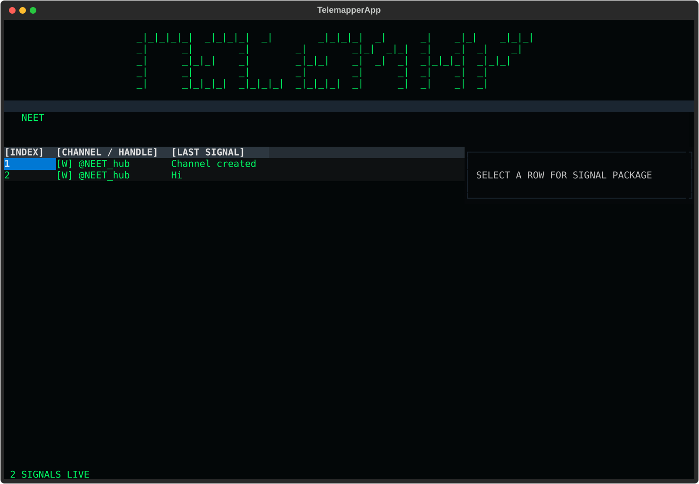

# TELEMAPPER

Map public Telegram channels. Follow the forwards. Keep the receipts.

Live API: **https://telemapper.vercel.app**



TELEMAPPER discovers public Telegram channels by keyword, scrapes their public previews, expands through forward chains, and seals everything into a forensic ledger: SHA256 per record, IST timestamps. The API persists every search to Postgres (Neon) and can export the evidence package as JSON or as a forensic PDF report. Built for tracking how narratives and leak material move through public Telegram, e.g. the NEET paper-leak channel economy.

## Boundary: public data only

Everything comes from `https://t.me/s/{channel}`, the public web preview Telegram serves without a login. No auth, no sessions, no Bot API tokens, no private groups. The crawler enforces this in code: `fetch_page()` rejects any target containing `+`, `joinchat`, or `api/auth` with a MISSION_ABORT. If Telegram stops serving a page publicly, the crawler records nothing and moves on. Anything that would need a login is out of scope by design, not by accident.

## How discovery works

Telegram exposes no keyword search without authentication, so there are two mechanisms:

1. **Probe patterns** (`discover_by_keyword`): the keyword plus five handle patterns (`{kw}_leak`, `{kw}_scam`, `{kw}_hub`, `official_{kw}`, `{kw}verified`). Only patterns that resolve to a real public page are kept. These are tripwires, not the main engine.
2. **Forward-chain expansion** (`expand_forward_chain`): forwarded messages name their source channel, so BFS over forwards is how the network reveals itself. This is the primary discovery mechanism. Each hop runs a keyword relevance check; irrelevant forwards are logged as `discovered_not_scraped`.

## Tags are candidates, not verdicts

The TUI tags channels `[K]` when the channel *name* contains "leak" or "scam", `[W]` otherwise. This is a triage heuristic on the name alone. A channel called "leak" may be an awareness channel, not a leak shop. Verify before labeling. The ledger records what was found, never what it means.

## Quickstart

```bash
pip install -r requirements.txt

# Terminal UI (local, SQLite ledger at ./data/telemapper_forensics.db)
python -m app.telemapper        # or: python diag_run.py (crash-capture wrapper)

# HTTP API (local)
uvicorn app.api:app --reload

# Local persistence: copy .env.example to .env and set DATABASE_URL.
# When DATABASE_URL is unset, the API runs on the in-memory ledger:
# scraping works, the forensic package rides inline in each response,
# and /api/export returns 503.

# Live checks
python verify_crawler.py        # fixed reference: the known-public "durov" channel
python test_neet.py             # live NEET keyword probe
```

## API reference

Base URL: `https://telemapper.vercel.app`

- `GET /api/health` — status and persistence mode (`postgres` or `memory`).
- `GET /api/discover?keyword=NEET&limit=10` — probe the five handle patterns for a keyword. Persists a search row and logs each discovered channel.
- `GET /api/channel/{channel}?pages=2` — scrape a channel's public preview. Each message is persisted as a signal with its SHA256 and IST seal timestamp. `pages` maps to ~20 messages per page; keep it low on serverless.
- `POST /api/expand` — JSON body `{"seed": ..., "keyword": ..., "max_hops": 2}` (1-3). BFS over forward chains from the seed channel.
- `GET /api/export?format=json&search_id=1` — dump a search: the search record, all its signals with forensic fields, and the discovery log.
- `GET /api/export?format=pdf&search_id=1` — the same evidence package as a forensic PDF report: TELEMAPPER banner header, search metadata, one package block per signal (channel, message id, URL, forward source, SHA256, IST seal timestamp, snippet).

Example:

```
curl "https://telemapper.vercel.app/api/discover?keyword=NEET&limit=5"
# -> {"keyword":"NEET","channels":[...],"count":5,"search_id":1}

curl "https://telemapper.vercel.app/api/channel/durov?pages=1"
# -> {"channel":"durov","message_count":20,"messages":[...],"forensic":{...},"search_id":2}

curl "https://telemapper.vercel.app/api/export?format=pdf&search_id=2" -o evidence.pdf
```

## Postgres (Neon) setup

The API persists to Postgres when `DATABASE_URL` is set. Schema lives in `schema.sql` and is applied automatically on first use (`PgStore` runs `CREATE TABLE IF NOT EXISTS`), so a fresh Neon database works with zero manual steps.

Tables:

- `searches` — one row per API search: id, query, created_at, result_count, status.
- `signals` — one row per scraped message: id, search_id, channel, message_id, text, forward_source, url, sha256, sealed_at_ist. Full raw HTML stays out of Postgres (too heavy); the text plus its hash is what persists.
- `discovered_channels` — every channel found: channel, discovery_method, reason, hop_distance, status, discovered_at.

Local dev: copy `.env.example` to `.env` and set `DATABASE_URL`. Never commit a real `DATABASE_URL`; `.env` is gitignored. On Vercel, `DATABASE_URL` is set as an encrypted environment variable on the project.

## Architecture

- **Vercel serverless → Neon Postgres.** The API has no disk, so the ledger runs in `:memory:` SQLite per invocation for the inline forensic package, while every search, signal, and discovery is written to Postgres for persistence and export.
- **Local TUI → SQLite.** The terminal UI writes to `./data/telemapper_forensics.db` (override with `TELEMAPPER_DB_PATH`; use `:memory:` for ephemeral runs). Full raw HTML per page is stored here: forensic custody means keeping the exact bytes that were hashed. A deep scrape at `max_depth=200` can add tens of MB per channel, so lower `max_depth` when disk matters. `seal_batch()` raises MISSION_ABORT if asked to ledger anything not from the public surface.

## Deploying on Vercel

`api/index.py` re-exports the FastAPI app; `vercel.json` routes all paths to it. Honest caveats:

- **No persistent disk.** Persistence is Neon, not the filesystem. The in-memory ledger still returns the forensic package inline per response.
- **Function duration vs scrape latency.** Each channel page costs one HTTP fetch plus a 2-3s politeness sleep. Deep scrapes will exceed serverless time limits. Keep `pages` low (default 2) and treat the API as a triage surface; run deep scrapes locally.
- **Cold starts** add latency to the first request.
- **Telegram rate-limits datacenter IPs.** Aggressive or repeated scraping from cloud egress IPs can get throttled. The 2-3s randomized sleep helps; it does not guarantee immunity.
- **Deployment Protection** must stay off for public access (it is off on this project).

## Layout

```
app/
  __init__.py
  crawler.py      # PublicPreviewCrawler: fetch, parse, scrape, discover, expand
  ledger.py       # ForensicLedger: SQLite evidence log (local TUI)
  pgstore.py      # PgStore: Postgres persistence (API)
  evidence_pdf.py # forensic PDF report builder (fpdf2)
  telemapper.py   # Textual TUI
  api.py          # FastAPI layer
api/index.py      # Vercel entrypoint
vercel.json
schema.sql        # Postgres schema (Neon)
.env.example      # DATABASE_URL placeholder for local dev
docs/screenshot.svg
diag_run.py       # TUI crash-capture wrapper
test_neet.py      # live NEET probe
verify_crawler.py # fixed-reference check against "durov"
requirements.txt
```
